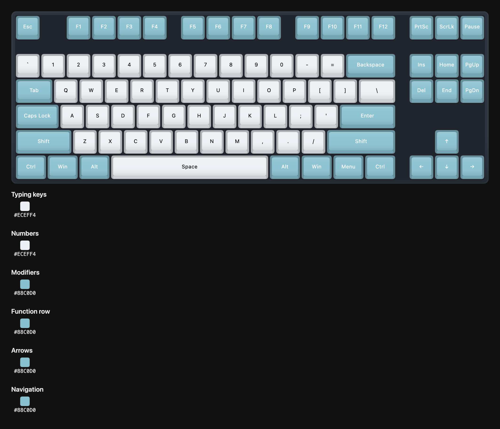

# KeyPalette

A lightweight, browser-based tool for designing and visualizing custom keycap colorways — before you buy.

No accounts. No installs. No uploads. Open it, pick a layout, and start painting your board.

**Try it:** [friedfishzyr.github.io/KeyPalette](https://friedfishzyr.github.io/KeyPalette/)



---

## What it does

Pick a keyboard layout, click your keys, and assign colors however you like — individually, by zone, or sampled from an inspiration photo. The keyboard is the canvas.

- **13 layouts** — 60%, 65%, 75%, TKL, and full-size in ANSI and ISO, plus HHKB, 96%, and a Planck 40% ortho
- **Interactive SVG keyboard** — every key is clickable, keyboard-navigable, and colorable
- **Zone selection** — color all typing keys, modifiers, arrows, or the numpad at once; Alt-click selects every key that shares a color
- **Image palettes** — extract the dominant colors from a PNG, JPG, or WebP
- **Keycap profiles** — flat by default, or simulated SA, OEM, Cherry, and DSA shading with per-row sculpting
- **Case and lettering** — case color and finish, auto-contrast or custom legend color, top or front legends
- **Undo / redo** — 50 steps per design, with the usual shortcuts
- **Five saved designs** — duplicate, rename, delete; everything stays in your browser
- **Share links** — the whole design travels in the URL, nothing is uploaded
- **Exports** — PNG with a color legend, SVG, or an editable JSON file; optional transparent background
- **Comparison mode** — your design next to a snapshot, a preset, or another saved design

## Layouts

| Layout | Keys | Notes |
|--------|-----:|-------|
| 60% / 60% ISO | 61 / 62 | Compact |
| 65% / 65% ISO | 68 / 69 | Arrows and a nav column |
| 75% / 75% ISO | 84 / 85 | Compact function row |
| TKL / TKL ISO | 87 / 88 | No numpad |
| Full-size / Full-size ISO | 104 / 105 | With numpad |
| HHKB | 60 | Split backspace, blocked bottom corners |
| 96% | 99 | Compact full-size |
| Planck | 47 | 40% ortholinear |

Key ids are shared across layouts wherever the physical key is the same, so switching layouts keeps your colors and JSON files stay portable.

## Getting started

```bash
npm install
```

```bash
npm run dev
```

Then open `http://localhost:5173/KeyPalette/`.

Other scripts:

| Script | What it does |
|--------|--------------|
| `npm test` | Runs the Vitest suite (history, storage, layouts, share links, export legend, app flows) |
| `npm run lint` | ESLint with the React hooks rules |
| `npm run format` | Prettier |
| `npm run build` | Production build into `dist/` |
| `npm run check` | Lint, test, and build in one go |

Node 20.19 or newer is required (see `.nvmrc`).

## How to use

1. **Choose a layout**, or open **Presets** to start from a colorway.
2. **Select keys**: click one, shift-click to add more, Alt-click to grab every key with the same color, or pick a key group. Tab to the board and use the arrow keys if you prefer the keyboard.
3. **Choose a color** in the Keycaps panel and click **Apply**. Switch between Hex, RGB, and HSL as needed, or **add colors from an image**.
4. **Style the case and lettering** in their tabs. Changes apply as you pick. Keycap profile lives under Keycaps.
5. **Undo or redo** from the top bar, ⌘/Ctrl+Z, ⌘/Ctrl+Shift+Z, or Ctrl+Y. History is separate per design and resets on reload.
6. **Name and keep designs** from the top bar. Changes save automatically in this browser. **My designs** holds up to five, with duplicate and delete.
7. **Compare** with a snapshot, a preset, or another saved design using **Compare**.
8. **Share** a link, or download a PNG, SVG, or editable JSON. Opening a JSON file replaces the active design and can be undone.

The **?** button lists every shortcut and lets you download a backup of everything saved in this browser.

## Sharing and privacy

Designs are stored only in your browser's local storage. There is no server, no account, no cookies, and no analytics. A share link encodes the entire design in the URL hash (deflated, about 600 characters for a TKL), so opening one never contacts anything but the page itself. Clearing site data removes your designs; the About dialog and every error screen offer a backup download.

## Project structure

```
keypalette/
├── index.html                 # Metadata, social tags, manifest link
├── public/                    # favicon, manifest, icons, social preview image
├── src/
│   ├── App.jsx                # Shell: header, toolbar, canvas, share-link import, notices
│   ├── components/
│   │   ├── Keyboard/          # Keyboard (roving focus, scale-to-fit), KeyCap (shaded render), Case
│   │   ├── Toolbar/           # Layout selector, zone pills, color panel, inline pickers
│   │   ├── ExportPanel/       # Share link, PNG / SVG / JSON, import
│   │   ├── ImagePaletteModal/ # Palette extraction from an image
│   │   ├── ComparisonView/    # Side-by-side boards
│   │   ├── Dialog.jsx         # Native <dialog> wrapper
│   │   ├── EditorHeader.jsx   # Design name, undo/redo, My designs, presets, notices
│   │   ├── AboutDialog.jsx    # Privacy note, shortcuts, backup
│   │   ├── Onboarding.jsx     # First-run card
│   │   └── ErrorBoundary.jsx  # Recovery screen with backup download
│   ├── data/
│   │   ├── layouts/           # Layout data, ISO derivation, layout metadata
│   │   ├── presets.js         # Built-in colorways (zone based)
│   │   ├── profiles.js        # Keycap profile shading parameters
│   │   └── zones.js           # Zone labels
│   ├── hooks/                 # useColorway (state + actions), useLocalStorage (debounced, safe), useMediaQuery
│   └── utils/                 # designHistory, designStore, exportJson, exportSvg, exportPng, share, keyShapes, colorUtils, download
├── tests/                     # Vitest (node + jsdom)
├── ARCHITECTURE.md            # State shape, storage schema, file and link formats
├── CHANGELOG.md
└── ROADMAP.md
```

See [`ARCHITECTURE.md`](./ARCHITECTURE.md) for the state shape and data formats.

## Deploying

KeyPalette is a static site hosted on GitHub Pages. Every push to `main` runs `.github/workflows/deploy.yml`, which runs `npm run check` and publishes `dist/` (the repo's Settings → Pages → Source must be set to "GitHub Actions").

The app is served from the `/KeyPalette/` sub-path, set by `base` in `vite.config.js`. To host it elsewhere, change `base` (use `'/'` for a domain root) and the absolute `og:url`, `og:image`, and `twitter:image` URLs in `index.html`. Designs live in the browser's local storage for the site's origin, so moving to a new domain leaves existing users' saved designs behind on the old one.

## Contributing

PRs are welcome — especially new layouts (`src/data/layouts/`, validated by `tests/layouts.test.js`), preset colorways, and rendering improvements. Run `npm run check` before opening one.

## License

[MIT](./LICENSE)
